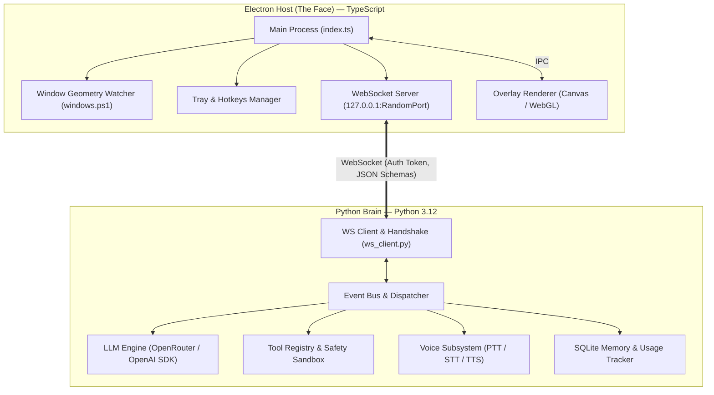
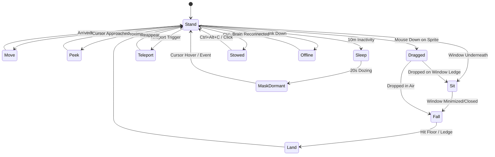
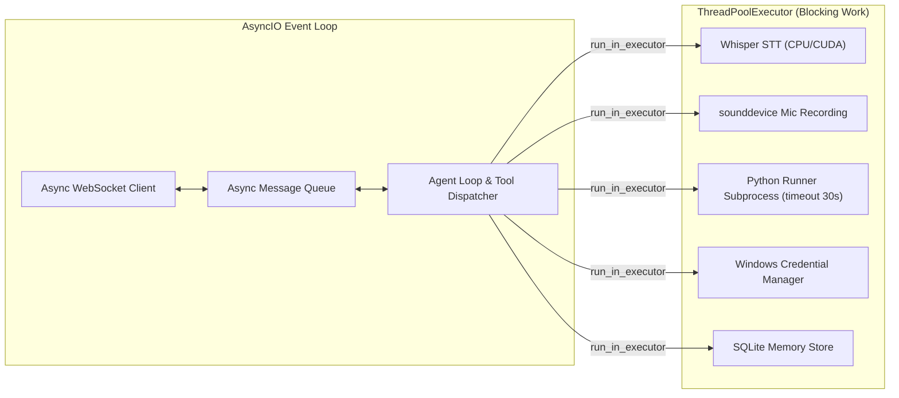

# Capri: System Architecture & Technical Specification

This document details the architectural design of **Capri**, covering process management, inter-process communication, the character state machine, frontend rendering pipelines, and the Python brain concurrency model.

---

## 1. High-Level System Architecture

Capri is architected as a **decoupled two-process system**:
1. **Electron Host ("The Face"):** Handles screen overlay rendering, WebGL character execution, visual effects, UI panels, global hotkeys, system tray, and window geometry tracking.
2. **Python Brain ("The Brain"):** Handles LLM communication (OpenRouter), character persona enforcement, tool execution, safety sandboxing, voice processing (local Whisper STT + TTS), SQLite memory, and token budget accounting.



---

## 2. Process Lifecycle & IPC Link

### 2.1. Process Spawning & Handshake
1. On startup, Electron selects a free random port on `127.0.0.1` and generates a 32-byte cryptographically secure random authentication token (`crypto.randomBytes(32).toString('hex')`).
2. Electron starts an in-process WebSocket server bound strictly to `127.0.0.1`.
3. Electron spawns the Python brain as a child process using Python 3.12:
   - `CAPRI_WS_PORT=<random_port>`
   - `CAPRI_WS_TOKEN=<random_token>`
   - `CAPRI_LOG_DIR=%APPDATA%\Capri\logs`
4. The Python brain connects to `ws://127.0.0.1:<port>`. It transmits an initial `handshake` payload containing the token.
5. If the token matches, the connection is accepted and `session_start` is emitted. If the token is invalid or absent, the connection is immediately terminated with HTTP 403 / WS close code 4403.
6. Connections with an `Origin` header are rejected to prevent malicious browser tabs from interacting with the local server.

### 2.2. Health Check & Fault Tolerance
- **Heartbeat:** Electron transmits a `ping` message every 5,000 ms. If no `pong` is received within 15,000 ms, the link is flagged as degraded.
- **Auto-Restart:** If the Python brain process crashes or exits unexpectedly, Electron updates the character state to `offline` (glitching outline, red construct tint) and initiates backoff restarts (after 1s, 3s, 10s, up to 3 attempts).
- **Graceful Shutdown:** When Electron quits (`will-quit` or Tray -> Quit), it sends an `abort` message, closes the WebSocket, and issues `SIGTERM` (falling back to `SIGKILL` after 2,000 ms) to guarantee no orphan Python processes remain.

---

## 3. Communication Protocol (`shared/protocol.md`)

All payloads are structured JSON objects adhering to JSON Schemas located in `shared/schemas/`.

### 3.1. Electron → Brain Messages
- `user_text { text: string }`: Chat input entered by user in transmission panel.
- `ptt_start {}`: Push-To-Talk hotkey pressed.
- `ptt_stop {}`: Push-To-Talk hotkey released.
- `approval_response { id: string, approved: boolean }`: User clicked Approve or Deny on an action.
- `abort {}`: Interrupt active thinking, tool execution, or TTS playback.
- `settings_update { settings: object }`: Configuration updates (model choice, language, budget, voice toggle).
- `ping { timestamp: number }`: Heartbeat query.

### 3.2. Brain → Electron Messages
- `session_start { version: string, model: string }`: Brain initialized and ready.
- `listening_start {}`: Mic recording active.
- `listening_level { rms: number }`: Real-time audio amplitude (0.0 to 1.0) for visual level indicator.
- `listening_end {}`: Recording finished, processing STT.
- `transcript { text: string, is_final: boolean }`: Local Whisper STT transcription.
- `thinking_start {}`: Model query initiated.
- `thinking_tick { elapsed_sec: number }`: Periodic counter while waiting for LLM completion.
- `thinking_end {}`: LLM response streaming finished.
- `assistant_delta { text: string }`: Incremental chunk of LLM text response.
- `assistant_message { text: string, face: string, badge?: string }`: Complete assistant message with emotional portrait tag.
- `tool_start { tool: string, target: string, ticker: string }`: Tool invoked (displays ticker above Capri's head).
- `tool_end { tool: string, ok: boolean, error?: string }`: Tool completed or failed.
- `needs_approval { id: string, kind: string, summary: string, details: string, diff?: string }`: Prompts user confirmation for dangerous tools.
- `approval_resolved { id: string, approved: boolean }`: Acknowledges resolved approval request.
- `tts_start { audio_url?: string, sample_rate?: number }`: Audio streaming begins (drives lip-sync).
- `tts_level { level: number }`: Real-time lip-sync level for speech animation.
- `tts_end {}`: Voice output finished.
- `task_done { actions: number, files_changed: number, duration_ms: number, last_sentence: string }`: Mission summary for victory animation.
- `usage { tokens_in: number, tokens_out: number, cost_usd: number, day_cost_usd: number }`: Real-time token and budget tracking.
- `error { message: string, code?: string }`: System or LLM error notification.

---

## 4. Character Rendering & UI Architecture

### 4.1. Rendering Architecture
- **Pure WebGL + TypeScript for Character Canvas:**
  The character is rendered via a single WebGL quad fragment shader. Frameworks such as React, Vue, or Svelte are strictly avoided in the character animation path. This eliminates virtual DOM reconciliation overhead and guarantees stable 12/24 fps rendering at <2% idle CPU.
- **Panel UI Architecture (Lit-html / Lightweight Vanilla DOM):**
  For UI panels (chat, settings, approval diff, mission report), we utilize lightweight template components (`lit-html` / vanilla typed DOM builders):
  - *Justification:* Lit-html provides declarative, type-safe HTML template literals with targeted DOM diffing, without bringing in the overhead of a full React runtime or state re-render cascades. Panels remain dormant in the DOM when closed.

### 4.2. Frame-Rate Capping & Dirty-Checking Pipeline
- **Idle State:** 12 fps ("on twos") with line boil.
- **Action State (Teleport, Hop, Victory, Flinch):** 24 fps ("on ones").
- **Dormant / Stowed State:** Render loop suspended. Canvas only redraws when an interaction or state change occurs.
- **Hidden Overlay:** `requestAnimationFrame` stops completely when Capri is hidden or minimized, reducing CPU usage to ~0%.



---

## 5. Python Brain Architecture & Concurrency Model

The Python brain is built on **Python 3.12 `asyncio`**:



### 5.1. Concurrency Breakdown
1. **AsyncIO Core Loop:**
   - Handles the WebSocket client connection, message serialization/deserialization, protocol validation, and streaming chunks from the OpenRouter API.
2. **ThreadPoolExecutor:**
   - Dedicated workers for CPU-bound or blocking I/O tasks:
     - `faster-whisper` speech transcription.
     - `sounddevice` / PyAudio microphone stream listening.
     - Subprocess sandbox for `run_python` (with strict 30-second watchdog timer).
     - SQLite read/write operations for personality memories.
     - Windows Credential Manager queries via `keyring`.
3. **Interruptibility:**
   - If user presses `Esc` or Electron sends `abort`, an active LLM streaming response is immediately canceled via `asyncio.Task.cancel()`, sub-processes are terminated, and TTS streams are drained.

---

## 6. Project File Layout

```text
capri-assistant/
├─ .gitignore
├─ LICENSE
├─ README.md
├─ THIRD_PARTY_NOTICES.md
├─ package.json
├─ tsconfig.json
├─ vite.config.ts
│
├─ app/                                 # Electron & Frontend (TypeScript)
│  ├─ assets/
│  │  ├─ capri/                         # Character graphics (.gitignore, personal use)
│  │  ├─ icons/                         # App icon & tray icon
│  │  └─ scripts/
│  │     └─ windows.ps1                 # Window geometry P/Invoke helper
│  └─ src/
│     ├─ main/                          # Electron Main Process
│     │  ├─ index.ts                    # Main entry point & app lifecycle
│     │  ├─ overlay.ts                  # Overlay window creation & positioning
│     │  ├─ ws-server.ts                # Localhost WebSocket server (token auth)
│     │  ├─ brain-process.ts            # Python brain child-process manager
│     │  ├─ windows.ts                  # Window tracking coordinator
│     │  ├─ tray.ts                     # System tray and context menu
│     │  ├─ hotkeys.ts                  # Global shortcut registration
│     │  └─ config.ts                   # Settings persistence & migration
│     ├─ preload/                       # Preload Script
│     │  └─ index.ts                    # Context bridge APIs
│     └─ renderer/                      # Overlay Renderer Process
│        ├─ index.html                  # Overlay markup
│        ├─ main.ts                     # Renderer initialization
│        ├─ character/                  # Character controller & stances
│        │  ├─ CapriController.ts       # Movement, physics, and state machine
│        │  └─ Chip.ts                  # Vector mask and biochip renderer
│        ├─ sprite/                     # WebGL Character Rig
│        │  ├─ SpriteRenderer.ts        # GLSL shader program & vertex buffers
│        │  └─ acting.ts                # Cel exposure sheets & pose definitions
│        ├─ fx/                         # Visual Effects
│        │  └─ FxLayer.ts               # Shards, bolts, speedlines, cut-ins
│        ├─ ui/                         # UI Panels & Ticker
│        │  ├─ Panel.ts                 # Transmission panel & decode animation
│        │  ├─ Ticker.ts                # Floating action ticker
│        │  ├─ ApprovalDialog.ts        # Approval prompt with diff viewer
│        │  ├─ ChatView.ts              # Interactive chat drawer
│        │  └─ MissionReport.ts         # Mission summary card & clipboard export
│        ├─ audio/                      # Audio Synthesis
│        │  └─ VoiceSynth.ts            # Web Audio live sound synthesizer
│        ├─ events/                     # Protocol Dispatcher
│        │  └─ EventDispatcher.ts       # Brain protocol message router
│        ├─ i18n/                       # Localization
│        │  └─ lines.ts                 # Character dialogue lines (RU/EN/FR/ES/PT)
│        └─ styles/
│           └─ capri.css                # Beveled panel styles, fonts & palette
│
├─ brain/                               # Python Brain (Python 3.12)
│  ├─ pyproject.toml / requirements.txt
│  ├─ main.py                           # Brain process entrypoint
│  ├─ ipc/
│  │  ├─ ws_client.py                   # Async WebSocket client with token auth
│  │  └─ protocol.py                    # JSON Schema message validator
│  ├─ llm/
│  │  ├─ provider.py                    # OpenRouter / OpenAI API client
│  │  ├─ models.py                      # Model slug verification & fallbacks
│  │  └─ budget.py                      # Token counter & daily dollar limit
│  ├─ persona/
│  │  ├─ persona.py                     # System prompt & voice rules (RU/EN)
│  │  └─ trimmer.py                     # Context truncation & summarization
│  ├─ tools/
│  │  ├─ registry.py                    # Tool decorator & schema registry
│  │  ├─ system_tools.py                # Apps, browser, media keys
│  │  ├─ file_tools.py                  # Sandboxed list_dir, read, write, edit
│  │  ├─ python_runner.py               # Subprocess Python execution in workspace
│  │  └─ safety.py                      # Path sanitizer & prompt-injection wrapper
│  ├─ voice/
│  │  ├─ recorder.py                    # Microphone capture via sounddevice
│  │  ├─ stt.py                         # faster-whisper local speech-to-text
│  │  └─ tts.py                         # HTTP TTS / Windows SAPI fallback
│  ├─ memory/
│  │  ├─ store.py                       # SQLite memory storage
│  │  └─ credentials.py                 # Windows Credential Manager (keyring)
│  └─ tests/                            # Pytest test suite
│     ├─ test_sandbox.py                # Path traversal & sandbox verification
│     ├─ test_tools.py                  # Tool schemas & approval logic
│     ├─ test_protocol.py               # JSON schema validation tests
│     └─ test_budget.py                 # Token accounting & budget limits
│
├─ shared/                              # Shared IPC Specifications
│  ├─ protocol.md                       # Protocol specification documentation
│  └─ schemas/                          # JSON Schemas for every message type
│
└─ docs/                                # Project Documentation & Artifacts
   ├─ design-notes.md                   # Reference analysis & module strategy
   ├─ architecture.md                   # This document
   ├─ assets-needed.md                  # Asset registry & specifications
   ├─ regression-checklist.md           # Stage-by-stage verification checklist
   └─ screens/                          # Test verification screenshots
```
